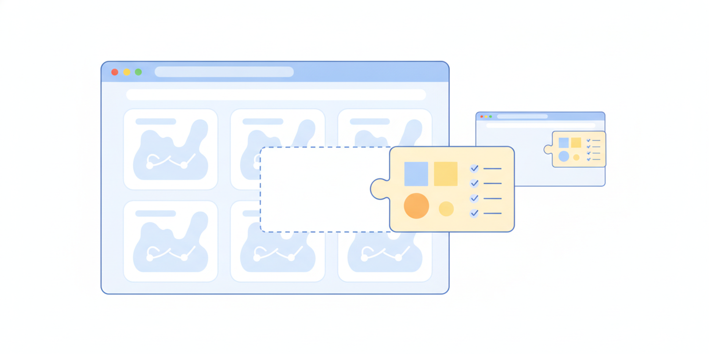
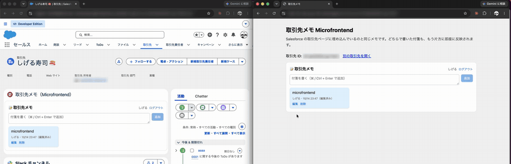
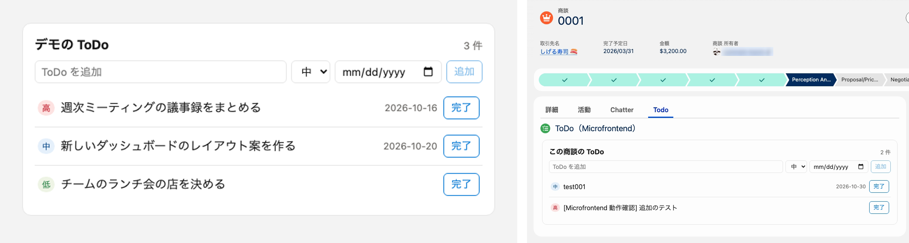
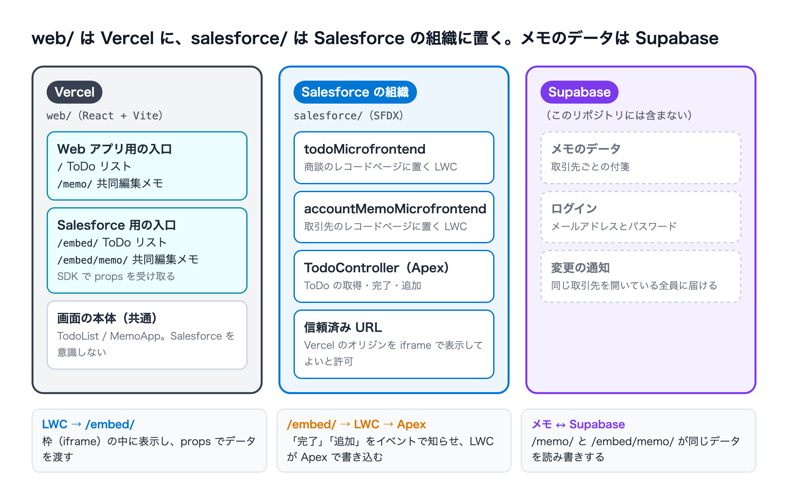
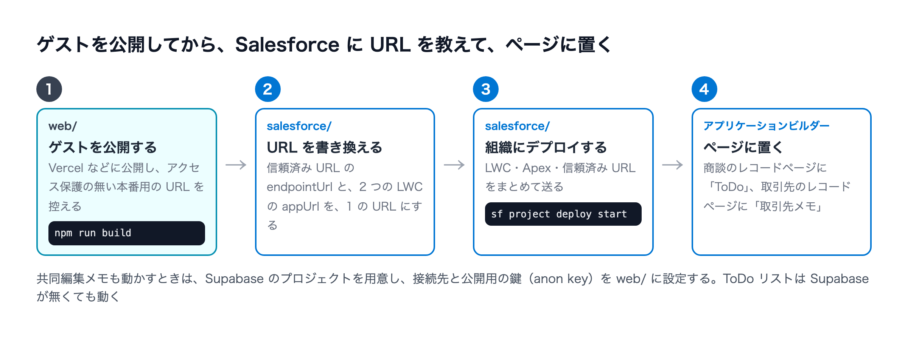

# salesforce-microfrontends-react



Web で作った React の画面を、Salesforce の画面の中にそのまま表示するデモです。Salesforce Microfrontends（UI Embedding / `lightning-ui-embedding`）を使っています。

解説記事: [Salesforce Microfrontends 入門 ― Web の React を小さな LWC で Salesforce に埋め込む](https://zenn.dev/4geru/articles/salesforce-microfrontends-react)



*Salesforce の取引先ページ（左）と Web アプリ（右）で、同じメモが同期する*



*Web アプリ（左）と Salesforce の商談ページ（右）。同じ部品で、表示するデータが違う*

| デモ | 内容 |
|---|---|
| **ToDo リスト** | 同じ React の部品が、Salesforce の商談ページではその商談の ToDo を、Web アプリではデモデータを表示する。Salesforce 側で「完了」「追加」すると、Salesforce の ToDo が更新される |
| **共同編集メモ** | Salesforce の取引先ページと Web アプリで、同じメモを読み書きする。Salesforce が渡すのは取引先 ID だけ |

2026 年 10 月時点、Developer Edition で動かしたものです。

## 構成



```
.
├ web/          React（Vite）。Vercel などに公開するゲスト
│  ├ src/components/TodoList.tsx   ToDo リストの部品（Salesforce を意識しない）
│  ├ src/memo/                     共同編集メモの部品
│  └ src/entries/                  入口（Web アプリ用と Salesforce 用）
├ salesforce/   SFDX。ホストの LWC・Apex・信頼済み URL
│  └ force-app/main/default/
│     ├ lwc/todoMicrofrontend/         ToDo リストのホスト（商談のレコードページ用）
│     ├ lwc/accountMemoMicrofrontend/  共同編集メモのホスト（取引先のレコードページ用）
│     ├ classes/TodoController.cls     ToDo の取得・更新・作成
│     └ cspTrustedSites/               ゲストのオリジンを iframe で表示する許可
├ docs/security.md   セキュリティのまとめ（CORS、sandbox、残っているリスク）
└ docs/images/      README の画像
```

`web/` の入口:

| URL | 中身 |
|---|---|
| `/` | Web アプリの ToDo リスト（デモデータ） |
| `/embed/` | Salesforce から読み込む ToDo リスト |
| `/memo/?account=<取引先ID>` | Web アプリの共同編集メモ |
| `/embed/memo/` | Salesforce から読み込む共同編集メモ |

## 前提

- Salesforce の組織: Enterprise / Performance / Unlimited / Developer / Partner Developer エディションで、Hyperforce 上にあり、**組織の既定の言語が英語**（ユーザーの言語は日本語のままでよい）。[公式ドキュメント](https://developer.salesforce.com/docs/platform/microfrontend/guide/get-started.html)
- Node.js（20 以上）、Salesforce CLI（`sf`）
- ゲストの公開先（このデモでは Vercel）

## 動かし方



### 1. ゲスト（React）を公開する

```bash
cd web
npm install
npm run dev      # ローカルで確認（http://localhost:5173/）
npm run build    # dist/ を Vercel などに公開する
```

公開先の URL は、**アクセス保護の無い本番用の URL** を使ってください。Vercel のデプロイごとの URL（`<プロジェクト>-<ハッシュ>-<チーム>.vercel.app`）は保護がかかっていて、iframe に表示できません。

### 2. Salesforce 側の URL を、自分の公開先に書き換える

次の 3 か所に、このデモの公開先（`https://todo-list-eta-puce-62.vercel.app`）が書かれています。自分の公開先に置き換えてください。

- `salesforce/force-app/main/default/cspTrustedSites/Todo_List_Microfrontend.cspTrustedSite-meta.xml` の `endpointUrl`（オリジンだけ。パスは付けない）
- `salesforce/force-app/main/default/lwc/todoMicrofrontend/` の `appUrl`（`.js` と `.js-meta.xml`）
- `salesforce/force-app/main/default/lwc/accountMemoMicrofrontend/` の `appUrl`（`.js` と `.js-meta.xml`）

`appUrl` は、配置後に Lightning アプリケーションビルダーの画面からも変えられます。

### 3. Salesforce にデプロイして、ページに置く

```bash
cd salesforce
sf org login web --alias my-org
sf project deploy start --source-dir force-app --target-org my-org --test-level RunSpecifiedTests --tests TodoControllerTest
```

デプロイ後、Lightning アプリケーションビルダーで配置します。

- 商談のレコードページ: 「ToDo（Microfrontend）」
- 取引先のレコードページ: 「取引先メモ（Microfrontend）」

## 共同編集メモについて

共同編集メモのログイン・保存・同期には [Supabase](https://supabase.com/) を使っています。**バックエンド（テーブルとアクセス制御）はこのリポジトリに含めていません。** 動かす場合は、次を自分で用意してください。

- Supabase のプロジェクトと、メモ用のテーブル（取引先 ID・本文・書いた人など）、メンバー表、行単位のアクセス制御
- `web/src/memo/config.ts` の `SUPABASE_URL` を自分のプロジェクトの URL に書き換える
- 公開用の鍵（anon key）を環境変数 `VITE_SUPABASE_ANON_KEY` に設定する（ローカルは `web/.env.local`、Vercel は環境変数）。管理者用の鍵（service_role）は使わないこと

```bash
# web/.env.local
VITE_SUPABASE_ANON_KEY=<anon key>
```

`VITE_` で始まる環境変数はビルドのときに埋め込まれます。Vercel で設定したら、もう一度公開し直してください。

ToDo リストは、このバックエンドが無くても動きます。

## つまずきやすい点

- **props の中身は文字列だけにする**: 配列やオブジェクトを props に入れると、ゲストの初期化が終わらなくなった（`lightning-ui-embedding` 2.2.5-rc.3、`@salesforce/platform-sdk` 12.9.0 で観察）。このデモは ToDo の一覧を JSON 文字列（`todosJson`）にして渡している
- **`<form>` を使わない**: `lightning-ui-embedding` に `sandbox` 属性を指定しないと、iframe の sandbox は `allow-scripts allow-same-origin` で、`allow-forms` が無い。フォーム送信はブラウザに止められ、`submit` イベントも発火しない。このデモはボタンのクリックと Enter キーで処理を呼んでいる
- **本番用の URL を使う**: 上の「1.」を参照

セキュリティ面のまとめは [docs/security.md](docs/security.md) にあります。
